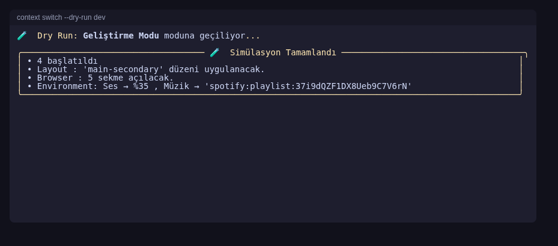
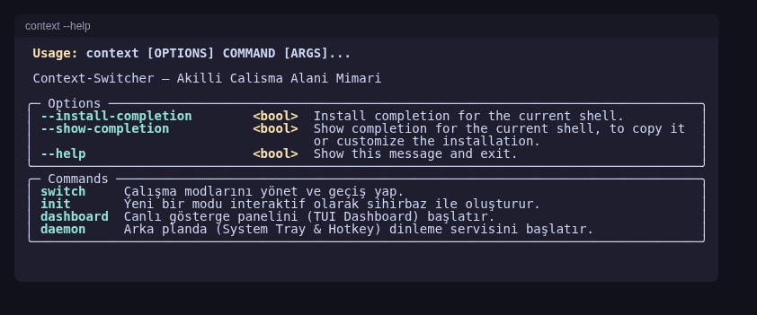
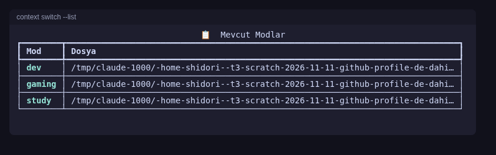

# 🧠 Context-Switcher

[](https://github.com/Shidori5417/Context-Switcher/actions/workflows/ci.yml)

> Tek komutla çalışma ortamı geçişi: Geliştirme, Ders, Oyun modları arasında süreçleri, pencere düzenini, tarayıcıyı ve sesi birlikte değiştirir.



## ✨ Özellikler

- **Süreç yönetimi** — Gereksiz uygulamaları dondur (suspend), gerekenleri başlat
- **Pencere düzeni** — Moda uygun yerleşim (`main-secondary` vb.)
- **Tarayıcı** — Profil ve sekme grupları
- **Ses & bildirim** — Ses seviyesi, bildirim susturma, otomatik müzik
- **Rollback** — Son geçiş `--rollback` ile geri alınır
- **Dry-run** — `--dry-run` ile değişiklik yapmadan ne olacağını gör
- **TUI dashboard, sistem tepsisi, global kısayollar** — `dashboard` ve `daemon` komutları
- **İzole hata yönetimi** — Bir agent hata verse de diğerleri devam eder; loglar `~/.context-switcher/logs/` altında

## 🚀 Kurulum

Paket PyPI'da yayınlanmış değildir; depodan kurun (Python 3.10+):

```bash
git clone https://github.com/Shidori5417/Context-Switcher
cd Context-Switcher
python -m venv .venv
source .venv/bin/activate     # Windows: .venv\Scripts\activate
pip install -e ".[dev]"
```

> Not: `jsonschema` modülü `pyproject.toml` bağımlılıklarında yok ama kodda kullanılıyor;
> `ModuleNotFoundError` alırsanız `pip install jsonschema` çalıştırın.

## 🕹️ Kullanım

```bash
context switch dev             # Geliştirme moduna geç
context switch --list          # Modları listele
context switch --status        # Aktif mod ve kurtarılan RAM
context switch --dry-run dev   # Simülasyon (değişiklik yapmaz)
context switch --rollback      # Son geçişi geri al
context init                   # Yeni mod sihirbazı
context dashboard              # Canlı TUI paneli
context daemon                 # Tepsi ikonu + global kısayollar
```

Windows'ta UTF-8 için `context.bat` kullanılabilir.

| `--help` | `--list` |
|---|---|
|  |  |

## 📁 Konfigürasyon

Modlar YAML dosyasıdır. Önce depodaki [`modes/`](modes/) (`dev`, `study`, `gaming`), sonra `~/.context-switcher/modes/` okunur; aynı adlı kullanıcı modu öncelik alır. Şema: [`schema/mode_schema.json`](schema/mode_schema.json).

```yaml
name: "Geliştirme Modu"
icon: "💻"
hotkey: "ctrl+alt+d"            # global kısayol (daemon)

processes:
  start: [code, docker]
  suspend: [discord, steam]

layout:
  arrangement: main-secondary
  primary_app: code

browser:
  profile: Work
  tab_groups:
    - name: Docs
      tabs: ["https://docs.python.org/3/"]

environment:
  volume: 35
  music:
    app: spotify
    playlist: "spotify:playlist:..."
```

## 🏗️ Mimari

Olay tabanlı (event bus) iletişimle çalışan beş agent; kod `src/agents/` altında. Ayrıntı: [`agents.md`](agents.md).

| Agent | Görev |
|-------|-------|
| Orchestrator | Geçiş koordinasyonu, snapshot |
| Process Manager | Süreç dondurma/başlatma |
| Layout Agent | Pencere düzeni |
| Browser Agent | Tarayıcı sekmeleri |
| Environment Agent | Ses, bildirim, müzik |

Teknoloji: Python, Typer + Rich (CLI/TUI), psutil, PyYAML + jsonschema, pystray, keyboard.

## 🧪 Geliştirme

```bash
pytest tests/ -v
ruff check src/ tests/
ruff format src/ tests/
```

Yol haritası: [`progress.md`](progress.md)

## 📄 Lisans

MIT (`pyproject.toml`'da belirtilmiştir; depoda ayrı bir `LICENSE` dosyası yok).
